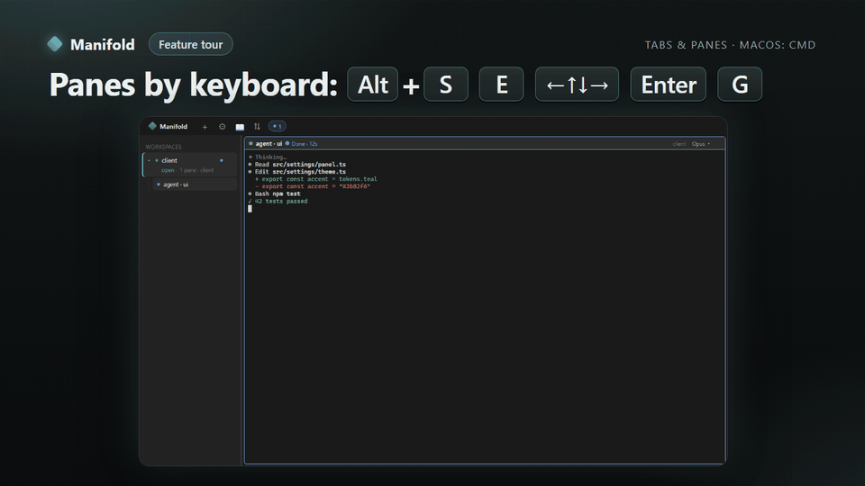

  <picture>
    <source media="(prefers-color-scheme: dark)" srcset="assets/banner-dark.svg">
    
  </picture>

I build developer tools, mostly the ones I was missing myself. The biggest is
[Manifold](https://manifold.rahnlab.de), a terminal for running many shell and coding-agent
sessions in one window. The rest are small utilities I use every day.

## Manifold

**[Manifold](https://manifold.rahnlab.de)** is a terminal for the way coding looks once agents
are involved: several sessions run at the same time, and the hard part is knowing which one
needs you. Claude Code, Codex, OpenCode and plain shells sit side by side in splits and tabs.
Each pane header shows whether its session is busy or waiting, and an SSH host opens as a
pane like any local folder.

I use it as my own terminal all day, and it is built inside itself, with several agent
sessions working in parallel in one window.

<table>
  <tr>
    <td align="center" valign="top" width="25%"><h3>3</h3>platforms from one codebase: Windows, macOS and Linux</td>
    <td align="center" valign="top" width="25%"><h3>4,876</h3>unit tests passing on the commit that shipped as 0.55.1</td>
    <td align="center" valign="top" width="25%"><h3>384</h3>end-to-end tests that drive the real app before a release</td>
    <td align="center" valign="top" width="25%"><h3>0</h3>accounts needed. Sync is optional and end-to-end encrypted</td>
  </tr>
</table>

Manifold is free during the open beta. Its source is not public, so there is no repository to
link here. You can [download it from the website](https://manifold.rahnlab.de) or ask
questions [on Discord](https://discord.gg/cM8n5sAYU3).

## Smaller things

<table>
  <tr>
    <td width="33%" valign="top">

### [claude-pulse](https://github.com/LukasRahn/claude-pulse)

A Claude Code plugin that tells you what Claude is doing without watching the terminal:
a status-line badge such as `EDITING badge.js`, the window title, and a notification when
it is done or needs you.

JavaScript, Claude Code plugin

</td>
    <td width="33%" valign="top">

### [TradeRepublicApi](https://github.com/LukasRahn/TradeRepublicApi)

An unofficial Python client for Trade Republic: portfolio, live quotes, orders, and an
export that imports into Portfolio Performance. It logs in the way the web app does, so
your phone stays logged in.

Python, command line and library

</td>
    <td width="33%" valign="top">

### [Streamdeck-Plugin](https://github.com/LukasRahn/Streamdeck-Plugin)

A Stream Deck plugin that draws one countdown across several keys, then shuts down,
restarts or sleeps the PC. Pressing any of the keys again cancels it.

TypeScript, Windows

</td>
  </tr>
</table>

## Toolbox

<table>
  <tr><td><b>Desktop</b></td><td>TypeScript, Electron, xterm.js, Node.js</td></tr>
  <tr><td><b>Testing and release</b></td><td>Vitest, Playwright, GitHub Actions, Docker</td></tr>
  <tr><td><b>Also</b></td><td>Python, C#</td></tr>
</table>

 

  <a href="https://www.linkedin.com/in/lukas-rahn-792397355">LinkedIn</a> or <a href="mailto:lukas@rahn.email">lukas@rahn.email</a>

